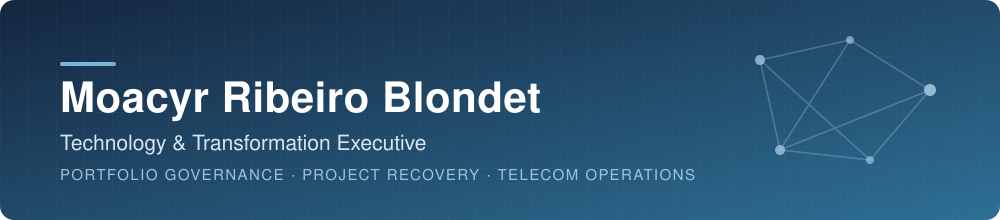

📍 Rio de Janeiro, Brazil &nbsp;·&nbsp; 🌎 Brazil · USA · Morocco &nbsp;·&nbsp; 🗣️ English · Spanish · Portuguese

 

---

## About me

Technology and transformation executive with **30+ years** across engineering, operations and enterprise software — from network startups to national-scale governance. Today I lead **Avalcorp**, a boutique consultancy for portfolio governance, project recovery, operational efficiency, process automation and digital transformation — **from strategy to execution** — combining that foundation with digital product delivery, software engineering and agentic AI.

> Teamwork is the secret of success — and I'm here on GitHub to evolve together.

## Methods & tools

**Management** &nbsp;

**Delivery & data** &nbsp;

**Automation & AI** &nbsp;

## Explore more

### Profile & contact

| | |
|:--|:--|
| 🔗 **Career** | Full professional background, roles and recommendations on [LinkedIn](https://www.linkedin.com/in/moacyrblondet/) |
| 🧭 **Profile** | Behavioral and professional assessment on [AssessFirst](https://app.assessfirst.com/_/profile/nk2sqo34-moacyr-blondet?lang=pt-BR) |
| ✉️ **Contact** | [E-mail](mailto:blondet.mr@gmail.com) · [Book a meeting](https://calendly.com/moacyrblondet/individual-meeting) |

### Current initiatives

| Project | What it is |
|:--|:--|
| 📣 **[ESG_VM](https://avalcorp.github.io/ESG_VM/)** | AI project that links project, fund and geospatial data to answer ESG questions from investors, NGOs and project managers. Repositories: [Orchestrators_IA](https://github.com/Moriblo/ESG_VM_Orchestrators_IA) · [Collectors](https://github.com/Moriblo/ESG_VM_Collectors) · [Datasets](https://github.com/Moriblo/ESG_VM_Datasets) |
| 🧪 **[OGT](https://github.com/Moriblo/OGT)** | *Orchestration for Governance & Testing* — framework to evaluate governed executions against defined requirements and produce evidence-based findings for human review. Currently at blueprint stage. |
| 🤖 **[MARGO](https://github.com/Moriblo/discord-migrator)** | Auditable agent that migrates Discord resources between servers, with human authorization gates for copy, validation and deletion. Repository foundation (Phase 0) in place. |
| 🗄️ **[repo_backup](https://github.com/Moriblo/repo_backup)** | Governed backup of GitHub repositories to OneDrive: human-approved command log, dispatcher workflow, preflight checks and evidence collection. |
| 🎓 **[MIT](https://github.com/Moriblo/MIT)** | Project work from *Agentic AI Applied to Business Transformation* (MIT Professional Education). |

### Academic portfolio

Postgraduate projects in Software Engineering at PUC-Rio (2023):

| Project | Focus |
|:--|:--|
| 📂 **[Multi-market Fund Evaluation](https://github.com/Moriblo/PUC_EngSoft_MVP4_avalfimult/blob/main/README.md)** | Machine Learning model for evaluating multi-market investment funds |
| 📂 **[Works of Art](https://github.com/Moriblo/moriblo/blob/main/README_Spt3PUC.md)** | Front end and microservice APIs (translator, museum search, artworks) packaged with Docker |

---

Rio de Janeiro, Brazil · Open to executive, interim and project-based engagements

